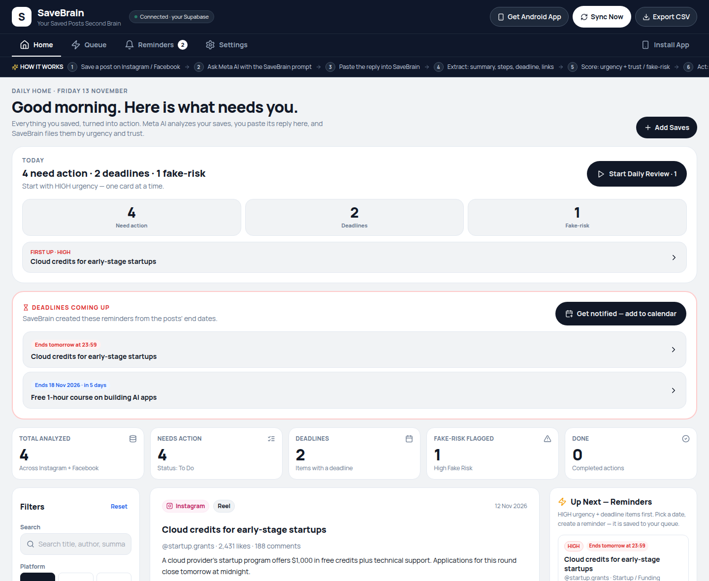
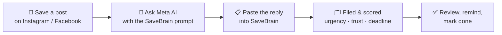
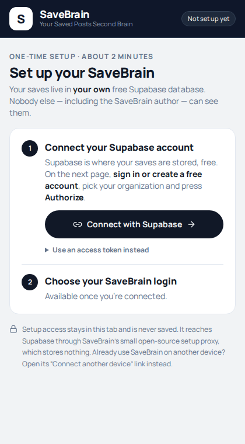
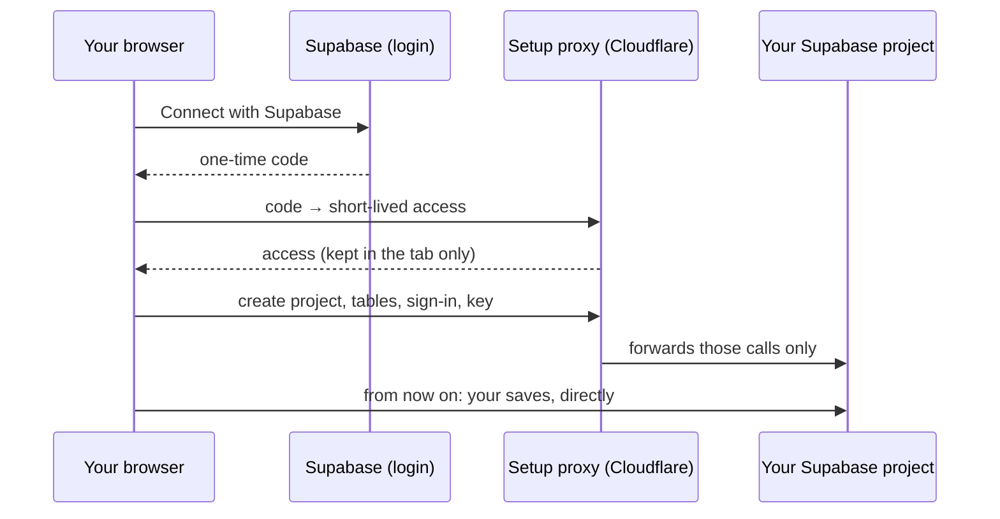
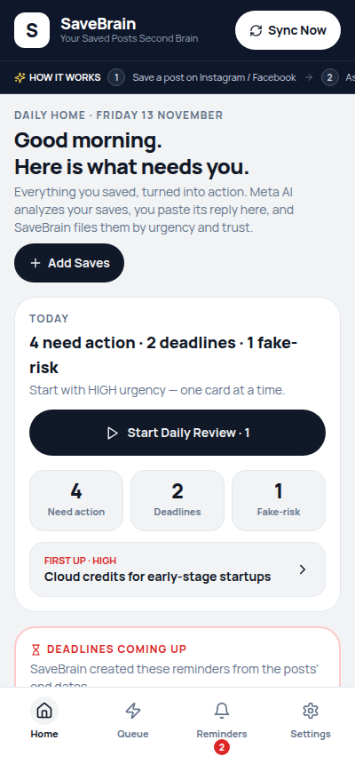

<div align="center">


# SaveBrain

### Your saved posts, turned into a second brain.

Stop losing the reels and posts you save. SaveBrain turns your Instagram & Facebook saves into a<br/>
private, prioritized to-do list — with deadlines, reminders and a built-in fake-claim detector.

<br/>

[](https://medamine-sudo.github.io/savebrain/)
&nbsp;
[](https://github.com/MedAmine-SUDO/savebrain/actions/workflows/deploy.yml)


<br/>



</div>

<br/>

## ✨ Why SaveBrain?

You save a reel about a free course, a startup grant, a job list, a tool to try… and never see it again.
Meanwhile the offer expires, the registration closes, and half of those "guaranteed income" posts were fake anyway.

**SaveBrain fixes that:**

- 🧠 **Every save becomes an action** — a clear summary, the steps, and the one next thing to do.
- ⏰ **Deadlines don't slip** — posts with an end date get a reminder automatically, straight into your phone's calendar.
- 🛡️ **Fake claims get flagged** — every save is scored for trust before you pay, share or act.
- 🔒 **Your data stays yours** — everything lives in *your own* free Supabase database. No shared server, no tracking.

<br/>

## 🚀 Features

<table>
<tr>
<td width="50%" valign="top">

### 🏠 Daily Home
What needs you today at a glance: actions, deadlines and fake-risk counts, plus a **Daily Review** that walks you through urgent saves one card at a time — *Done*, *Snooze* or *Next*.

### 🔍 Full analysis
Each save gets a summary with the concrete details, extracted step-by-step instructions, *why* it's urgent, trust signals, every link mentioned, and a checklist.

### 🌍 In the post's own language
Arabic, French, English, Tunisian dialect… the analysis is written in the language of the post, with proper right-to-left display.

</td>
<td width="50%" valign="top">

### ⏰ Automatic deadline reminders
"Offer ends Friday", "registration closes tomorrow", "48 hours only" — SaveBrain turns them into reminders for the day before. One tap adds them to your calendar with alerts.

### 🛡️ Fake detector
Every save is rated **Verified · Likely Legit · Check Claims · High Fake Risk**, based on red flags like sales screenshots, guaranteed income and comment-gated offers.

### 📱 Works everywhere
Installable on Android like a native app, QR code to connect your other devices, filters & search, CSV export, light & dark mode.

</td>
</tr>
</table>

<br/>

## ⚙️ How it works

Instagram and Facebook don't let apps read your saved posts — but **Meta AI can see them**.
SaveBrain gives you a ready-made prompt, Meta AI does the analysis, and SaveBrain organizes the result.



### 🤔 Why Meta AI, and not ChatGPT, Claude or Gemini?

| | Meta AI | Other assistants (in my tests) |
| --- | --- | --- |
| **Sees your saved posts** | ✅ Native to Instagram & Facebook — your saves are right there | ❌ No access to your account |
| **Opens a reel / post link** | ✅ Reliably | ❌ Often fails or errors on Instagram reel URLs |
| **Understands the content** | ✅ The video, the caption and the context | ❌ Can't analyze what it can't open |

Meta AI isn't the "smartest model" choice — it's the only one that **can actually see the data**.
The prompt does the rest: strict JSON, clear rubrics, and "never invent posts or links".

<details>
<summary><b>What I tried before landing on Meta AI</b></summary>
<br/>

- **Make.com + the share sheet** — an HTTP shortcut sent each shared link to a Make.com webhook.
- **ntfy** — pushing shared links through a notification relay.
- **General-purpose LLMs** — pasting reel URLs into other assistants.

The first two could move a *link* around, but a link alone says nothing about what's in the reel.
The LLMs couldn't reliably open Instagram links, let alone understand the video.
Meta AI was the first approach that could both **reach** the saves and **understand** them.

</details>

<br/>

## 🏁 Get started — about 2 minutes, no coding

<table>
<tr>
<td width="62%" valign="top">

1. **Open [SaveBrain](https://medamine-sudo.github.io/savebrain/) and press Connect with Supabase.**
2. **On Supabase's page,** sign in (or create a free account), pick your organization and press **Authorize**.
3. **Back in SaveBrain,** choose an email and password and press **Set up SaveBrain**.

That's it. SaveBrain then, automatically:

- creates your own Supabase project,
- sets up the tables and privacy rules,
- configures sign-in and creates your account,
- locks sign-ups so nobody else can use your project.

<details>
<summary><b>Prefer an access token? (fallback)</b></summary>

Under **Use an access token instead**, paste a [token](https://supabase.com/dashboard/account/tokens) made with these settings:

- **Expiry:** the shortest option. Setup takes about 2 minutes.
- **Access:** your organization, with all its projects (needed to create the new project).
- **Permissions:** leave everything else off and turn on only these:

| Permission | Level |
|---|---|
| Organizations | Read |
| Projects (account-wide) | Read |
| Organization Projects | Read-write |
| Project Settings | Read-write |
| Database | Read-write |
| Auth Config | Read-write |
| API Keys | Read-write |
| API Key Secrets | Read |

If one is missing, SaveBrain names it so you can create a new token with it.
</details>

> 💡 SaveBrain's access is only used during setup and never stored. Afterwards you can remove it in your Supabase account settings (or delete the token, if you used one).

> ℹ️ Free Supabase plans allow 2 active projects. Already at 2? Choose an **Existing project** and SaveBrain adds its tables to that project, leaving everything else untouched.

</td>
<td width="38%" valign="top" align="center">

</td>
</tr>
</table>

<details>
<summary><b>How setup works under the hood</b></summary>
<br/>

Supabase's Management API refuses calls from browsers, so setup goes through a tiny [Cloudflare Worker](proxy/worker.js). It holds SaveBrain's OAuth secret, forwards only the calls setup needs, and stores and logs nothing. After setup, the app talks to **your** project directly; the Worker is never used again.



</details>

<br/>

## 🤖 Adding your saves with Meta AI

<table>
<tr>
<td width="62%" valign="top">

1. In SaveBrain, press **Add Saves → Import from Meta AI** and copy a prompt:
   - **All my saves** — for a first import,
   - **Last 24 hours** — for your daily routine.
2. Paste it into **Meta AI** (in Instagram, WhatsApp or [meta.ai](https://www.meta.ai)).
3. Copy Meta AI's **whole** reply and paste it back into SaveBrain.

Links already in SaveBrain are skipped, and reminders are created for every upcoming deadline.

#### 🔁 Daily sync
Ask Meta AI: *"Every day at 7:00, run this:"* followed by the **Last 24 hours** prompt. Each morning, paste its reply into SaveBrain.

#### 🔗 Just one post?
**Add Saves → Paste a link** files it right away, and **Copy Meta AI prompt for this link** gets you its full analysis.

> ⚠️ AI can make mistakes. Every card keeps the original link — open it to confirm before acting.

</td>
<td width="38%" valign="top" align="center">

</td>
</tr>
</table>

<br/>

## ⏰ Deadline notifications

When a post mentions an end date, SaveBrain creates a reminder for the **day before** (or today, if it's that close) and shows it on Home under **Deadlines coming up**.

Press **Get notified — add to calendar** and open the downloaded file. Your phone's calendar then alerts you:

| Post gives… | You're alerted |
| --- | --- |
| a date | at 9:00 the day before, and at 9:00 on the day |
| a date and a time | 1 day before, and 2 hours before |

Calendar alerts work even when SaveBrain is closed. Add new deadlines to your calendar after each import.

<br/>

## 🔒 Privacy & security

| | |
| --- | --- |
| 🏠 **Your own database** | Each person uses their own free Supabase project. Your saves never pass through a SaveBrain server, and the SaveBrain author can't see them. |
| 🔑 **No keys in this repo** | Nothing secret is committed or deployed. Your browser only stores your project's address and its *publishable* key — the app refuses secret keys. |
| 🛡️ **Row Level Security** | Every row belongs to a user, and the database only lets signed-in users read their own rows. See [`supabase/schema.sql`](supabase/schema.sql). |
| 🚪 **Locked sign-ups** | On projects created by setup, sign-ups are disabled once your account exists. |
| 🎟️ **One-time access** | Setup access is kept in the open tab and never saved. It reaches Supabase through a tiny [open-source proxy](proxy/worker.js) (Supabase blocks direct browser calls) that only allows setup's calls and stores and logs nothing. |

<br/>

## 📖 Guides

<details>
<summary><b>📱 Use SaveBrain on another device</b></summary>
<br/>

On your first device, go to **Settings → Connect another device**, then scan the QR code (or open the link) on the other device and sign in.
The link holds your project's address and publishable key — never your password. Only open it on your own devices.

</details>

<details>
<summary><b>📲 Install it on your Android phone</b></summary>
<br/>

Open SaveBrain in Chrome → **⋮ menu → Add to Home screen / Install app**. It opens fullscreen with its own icon.
Want a Play Store app? Wrap it with [PWABuilder](https://www.pwabuilder.com) (Trusted Web Activity) — steps are in the app under **Install App**.

</details>

<details>
<summary><b>🛠️ "Your database needs a one-time update"</b></summary>
<br/>

SaveBrain gained new features and your database needs the matching columns. In the banner, press **Copy update → Open SQL Editor**, paste, press **Run**, then **Done — reload**.
It's safe to run more than once and keeps your saves.

</details>

<details>
<summary><b>🔑 I forgot my password</b></summary>
<br/>

Still signed in on another device? You don't need it there. Otherwise, set a new one from your Supabase project: open the **SQL Editor**, paste this with your SaveBrain email and a new password, and press **Run**:

```sql
update auth.users
set encrypted_password = extensions.crypt('YOUR-NEW-PASSWORD', extensions.gen_salt('bf'))
where lower(email) = lower('you@example.com');
```

It should say **1 row affected** (0 means the email doesn't match — check it under **Authentication → Users**). Then sign in with the new password. Your saves aren't touched.

</details>

<details>
<summary><b>🗄️ I had saves from before accounts existed</b></summary>
<br/>

Give them to your account by running this once in the Supabase SQL Editor:

```sql
update savebrain_items
set user_id = (select id from auth.users where email = 'you@example.com')
where user_id is null;
```

</details>

<details>
<summary><b>❓ Does "All my saves" return everything I ever saved?</b></summary>
<br/>

Not reliably. A single Meta AI reply can only hold a limited number of analyzed posts, and Meta AI may only look at recent saves.
Use it for a first import and the daily prompt for new saves. A full-history import from Meta's official data export is on the roadmap.

</details>

<br/>

## 🧰 Tech stack

| Layer | Technology |
| --- | --- |
| Frontend | React 18 · TypeScript · Tailwind CSS · Vite |
| Icons & QR | lucide-react · qrcode |
| Data & auth | Supabase (Postgres + Row Level Security + Auth), one project per user |
| Setup | "Connect with Supabase" (OAuth with PKCE) + the Supabase Management API |
| Setup proxy | A stateless [Cloudflare Worker](proxy/worker.js): finishes the OAuth login and forwards setup's calls (Supabase blocks them from browsers) |
| Hosting | GitHub Pages, built and deployed by GitHub Actions |

<details>
<summary><b>Project structure</b></summary>
<br/>

```
├── src/
│   ├── App.tsx                 # Dashboard: Home, Queue, Reminders, Settings
│   ├── main.tsx                # Setup → sign-in → app
│   ├── components/             # Setup, sign-in, Add Saves, device link, update banner
│   └── lib/
│       ├── items.ts            # Meta AI prompt + reply parser, row mapping, dates
│       ├── setup.ts            # "Connect with Supabase" + one-time project setup
│       ├── calendar.ts         # .ics export with alarms
│       └── config.ts           # Per-browser project config, device links
├── proxy/                      # Cloudflare Worker used only during setup
├── supabase/schema.sql         # Tables, migrations and privacy rules
├── public/                     # Icons and web app manifest
└── .github/workflows/deploy.yml
```

</details>

<br/>

## 💻 Development

```bash
git clone https://github.com/MedAmine-SUDO/savebrain.git
cd savebrain
npm install
npm run dev      # http://localhost:5173
npm run build    # type-check + production build in dist/
```

Pushing to `main` builds and deploys to GitHub Pages automatically.
To deploy your own fork, enable **Settings → Pages → Source: GitHub Actions**.

<details>
<summary><b>Run your own setup proxy (forks)</b></summary>
<br/>

Setup needs an OAuth app and the small proxy in [`proxy/`](proxy/), because Supabase's Management API refuses calls from browsers.

1. In your Supabase organization, open **Settings → OAuth Apps → Add application**. Use your site's URL as the callback URL and enable: Organizations read, Projects read + write, Database read + write, Auth read + write, Secrets read + write.
2. Put the Client ID in `proxy/wrangler.toml` (`CLIENT_ID`) and in `src/lib/setup.ts` (`OAUTH_CLIENT_ID`), and your site's origin in `ALLOWED_ORIGINS`.
3. Deploy the Worker and store the secret:
   ```bash
   cd proxy
   npx wrangler deploy
   npx wrangler secret put CLIENT_SECRET
   ```
4. Build the site with your Worker's address: `VITE_SETUP_PROXY=https://<name>.<you>.workers.dev npm run build` (or change the default in `vite.config.ts`).

</details>

<br/>

## 🗺️ Roadmap

- [ ] Import your full history from Instagram / Facebook's official data export
- [ ] "Analyze next 10" batches that upgrade existing saves with the latest analysis
- [ ] Push notifications for deadlines, without the calendar step
- [ ] "Forgot password?" on the sign-in screen
- [ ] Refresh automatically when you come back to the app, instead of the "Sync Now" button

<br/>

<div align="center">

Made with ☕ by [**MedAmine-SUDO**](https://github.com/MedAmine-SUDO)

If SaveBrain saves you from a missed deadline, consider giving it a ⭐

</div>
